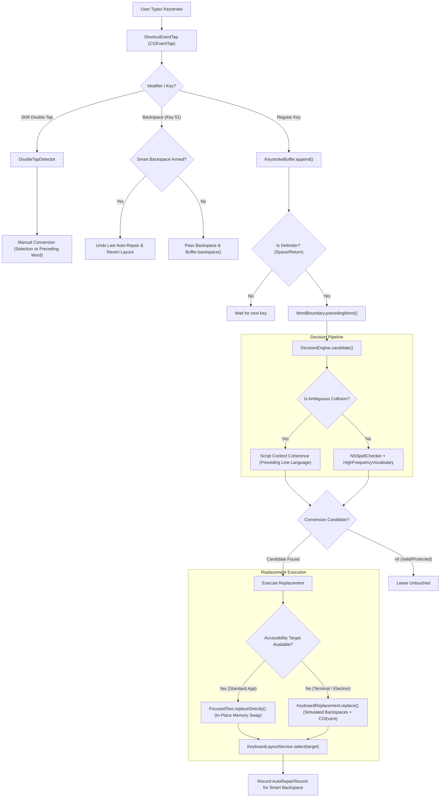

# HeSwitch — Master Project Summary & Complete Recreation Blueprint

> **Current Version:** `v1.0.14`  
> **Target OS:** macOS 14.0+ (Sonoma, Sequoia)  
> **Language / Toolchain:** Swift 5.9+ (Swift Package Manager), Python 3.11+ (Test Suite managed with `uv`)  
> **Application Type:** Native macOS Menu Bar Agent (`LSUIElement = 1`)  
> **GitHub Repository:** `https://github.com/dboriska/HeSwitch`

---

## 1. Executive Summary & Mission

**HeSwitch** is an ultra-lightweight, native macOS menu-bar utility designed to automatically detect and repair words and phrases accidentally typed in the wrong Hebrew or English keyboard layout.

### Guiding Principles:
1. **100% On-Device & Privacy First:** Zero telemetry, zero internet calls during operation, zero external LLM/AI bloat. Detection uses Apple's native `NSSpellChecker` and local high-frequency lexicons.
2. **Zero Clipboard Pollution:** HeSwitch never modifies, reads, or overwrites the macOS system pasteboard during automatic text replacement.
3. **Zero False-Positives Priority:** Corrupting text a user intended to type is catastrophic. When uncertain, HeSwitch leaves the text untouched.
4. **Pure Native Swift Architecture:** Relies solely on native Apple frameworks (`SwiftUI`, `AppKit`, `Carbon`, `ApplicationServices`, `ServiceManagement`). Compiles in seconds with standard Xcode Command Line Tools.

---

## 2. Complete Repository File Inventory

```
autoSwithc_he_eng/
├── .github/
│   └── workflows/
│       └── build.yml                     # GitHub Actions CI/CD (Swift tests + app packaging + artifact release)
├── install.sh                            # Universal curl-pipe-bash installer & updater for macOS
├── test_layout_switcher.py               # Deterministic behavioral test harness (2,204 typing test cases)
├── test_huge_vocabulary.py               # Massive vocabulary stress test (59k EN + 129k HE words)
├── ARCHITECTURE.md                       # High-level architecture and design philosophy
├── README.md                             # User documentation, installation guide, and feature overview
├── PROJECT_SUMMARY.md                    # Master reproduction blueprint (this file)
├── tests/
│   └── vocabularies/
│       ├── words_en_3000.txt             # High-frequency English baseline
│       ├── words_en_59k.json             # Large English dictionary
│       └── hebrew_hspell_129k.txt        # Comprehensive morphological Hebrew lexicon (Hspell)
└── HeSwitch/                             # Swift Package Manager root
    ├── Package.swift                     # Swift 5.9 Package manifest
    ├── install.sh                        # Local installation and permission reset script
    ├── Scripts/
    │   └── package-app.sh                # App bundle builder, Info.plist generator, and packager
    ├── Tests/
    │   └── HeSwitchTests/
    │       └── HebrewConversionTests.swift # Swift unit tests (conversions, boundaries, context coherence)
    └── Sources/
        └── HeSwitch/
            ├── AmbiguousCollisions.swift     # Registry of dual-language collisions (to/אם, do/גם, md/צג, kph/לפי)
            ├── AppUpdater.swift              # In-app background update checker and atomic updater
            ├── ApplicationExclusions.swift   # Bundle ID blacklist (IDE code editors, games, virtual machines)
            ├── CustomDictionary.swift        # User-defined custom words persisted in UserDefaults
            ├── DecisionEngine.swift          # Linguistic arbitration engine & script context analysis
            ├── DoubleTapDetector.swift       # Double-tap modifier detection (Double-Tap Shift)
            ├── ExcludedWords.swift           # Language-scoped word blacklist ([EN], [HE], [ALL])
            ├── FocusedText.swift             # Accessibility API client (focused element, text ranges, replacement)
            ├── HeSwitchApp.swift             # App entrypoint, NSStatusBar item, event loops, undo handling
            ├── HighFrequencyVocabulary.swift # Morphological bypass lexicon (and, what, how, צג, אני, לפי)
            ├── KeyboardLayoutService.swift   # Carbon Text Input Services (TIS) input source switcher
            ├── KeyboardReplacement.swift     # Low-level CGEvent keystroke generator & fallback paste
            ├── KeystrokeBuffer.swift         # Ring buffer tracking typed words & context for terminals
            ├── LaunchAtLogin.swift           # SMAppService & AppleScript login item manager
            ├── LayoutConversion.swift        # SI-1452 physical layout transcoder & Geresh 'w' mapper
            ├── SettingsView.swift            # Native SwiftUI settings interface
            ├── SettingsWindowManager.swift   # Dedicated NSWindow controller with AppKit Edit menu
            ├── ShortcutEventTap.swift        # Global CGEventTap manager for keyboard shortcuts
            ├── SwitchSoundPlayer.swift       # Audio feedback on conversion (NSSound)
            └── WordBoundary.swift            # Tokenizer parsing preceding words & Hebrew punctuation
```

---

## 3. Core Subsystems & Technical Architecture



---

### 3.1 Event Hooking & Keystroke Interception
- **`ShortcutEventTap.swift`:**
  - Installs an active event tap via `CGEvent.tapCreate(tap: .cghidEventTap, place: .headInsertEventTap, options: .defaultTap, eventsOfInterest: ...)` listening for `.keyDown` and `.flagsChanged`.
  - Automatically recovers from tap disablement (`kCGEventTapDisabledByTimeout` or `kCGEventTapDisabledByUserInput`) by re-enabling via `CGEvent.tapEnable`.
  - Tags its own synthesized events with `0x48655377` (`"HeSw"`) in `.eventSourceUserData` to prevent infinite recursive interception loops.
- **`DoubleTapDetector.swift`:**
  - Tracks timestamp of modifier releases. If Shift is released and pressed again within `300ms` without intervening keys, it triggers manual repair.

---

### 3.2 Accessibility & Focused Element Introspection
- **`FocusedText.swift`:**
  - Queries `AXUIElementCreateSystemWide()` for `kAXFocusedUIElementAttribute`.
  - Automatically enables dormant accessibility trees in Chromium, Chrome, and Electron apps by setting `AXManualAccessibility = true`.
  - **Secure Input Protection:** Checks `kAXSecureTextFieldSubrole` and Carbon's `IsSecureEventInputEnabled()`; immediately bypasses password boxes to maintain macOS security guarantees.
  - Fetches the active selection or cursor position via `kAXSelectedTextRangeAttribute` and retrieves surrounding string content via `kAXValueAttribute` or `kAXSelectedTextAttribute`.

---

### 3.3 Physical Layout & Transcoding Engine (`LayoutConversion.swift`)
- Maps standard physical keys between US QWERTY and Israeli standard layout (SI-1452 / macOS Hebrew):
  - English: `` `1234567890-=qwertyuiop[]\asdfghjkl;'zxcvbnm,./ ``
  - Hebrew:  `;1234567890-=/ 'קראטוןםפ][\שדגכעיחלךף,זסבהנמצתץ.`
- **Punctuation-as-Letter Mappings:**
  - `,` $\rightarrow$ `ת` (`t,v` $\rightarrow$ `אתה`)
  - `.` $\rightarrow$ `ץ` (`ru.` $\rightarrow$ `רוץ`)
  - `;` $\rightarrow$ `ף` (`xu;` $\rightarrow$ `סוף`)
  - `'` $\rightarrow$ `,` (Hebrew comma)
  - `w` / `W` $\rightarrow$ `׳` (Hebrew Geresh U+05F3) or `'`
- **Capitalized English Transcoding:**
  - When typing with `Shift` on Hebrew layout, macOS produces English uppercase letters or Gershayim `״` (Shift+W).
  - Handles patterns like `Wישא` $\rightarrow$ `What`, `Hקךךם` $\rightarrow$ `Hello`, and `״םרךג` $\rightarrow$ `World`.

---

### 3.4 Decision Engine Pipeline (`DecisionEngine.swift`)
Before any text is changed, it passes through strict validation:
1. **Length Bounds:** Words must be between 2 and 40 characters.
2. **Excluded Words & Applications:** Checked against `ExcludedWords` (language-scoped) and `ApplicationExclusions`.
3. **Ambiguous Collisions & Line Context Script Coherence:**
   - Pairs in `AmbiguousCollisions.swift` (`to`/`אם`, `do`/`גם`, `go`/`עם`, `so`/`דם`, `no`/`נם`, `md`/`צג`, `tbh`/`אני`, `kph`/`לפי`).
   - Analyzes preceding text via `scriptOfContext(context)`:
     - **In Hebrew Context:** Accidental English converts to Hebrew (`שלום, tbh` $\rightarrow$ `אני`); Hebrew typing remains untouched (`שלום, אני` remains `אני`).
     - **In English Context:** Accidental Hebrew converts to English (`I think אני` $\rightarrow$ `tbh`); English typing remains untouched (`I think tbh` remains `tbh`).
     - **In Neutral / Standalone Context:** Words stay untouched unless governed by a dedicated rule (such as `kph`).
4. **Specialized `kph` $\leftrightarrow$ `לפי` Resolution:**
   - In English, `kph` is exclusively an abbreviation for "km/h" and only appears after numbers (`100 kph`) or in English sentences.
   - In Hebrew, `לפי` is one of the top 30 most common words and a primary sentence starter (`לפי דעתי...`).
   - At start of line (`.neutral`) or in Hebrew lines (`.hebrew`), `kph` converts to `לפי`.
   - If preceded by digits (`100 kph`) or in an English line (`.english`), `kph` is kept in English.
5. **CLI & Markdown `.md` / `צג` Handling:**
   - `README.צג` converts to `README.md`.
   - CLI commands (`cat צג`, `vim צג`) convert to `md`.
6. **Contractions & Decimal Numbers Protection:**
   - Words like `don't`, `it's`, `can't` and numbers like `3.14`, `1,000` are never converted to Hebrew.
7. **High Frequency Morphology Bypass (`HighFrequencyVocabulary.swift`):**
   - High-frequency English words (`and` [שמג], `what` [׳ישא], `how` [ים׳], `add` [שגג]) bypass `NSSpellChecker` morphological misidentifications.

---

### 3.5 Text Replacement & Smart Backspace Undo
- **In-Place Replacement (`replaceDirectly`):**
  - Uses `AXUIElementSetAttributeValue(element, kAXSelectedTextRangeAttribute)` and `kAXSelectedTextAttribute`.
  - Replaces characters in process memory without touching the clipboard or simulating key events.
- **Keystroke Fallback (Terminals, Electron, WebViews):**
  - Sends exact backspaces via `CGEventPost`, then emits replacement Unicode characters with the `0x48655377` signature.
- **Smart Backspace Undo (Preserving Leading Delimiters):**
  - Configurable via `SmartBackspaceMode`:
    - **Single-Tap:** Pressing Backspace within 2.0s immediately undoes the conversion and restores the typed layout.
    - **Two-Stage:** 1st Backspace deletes the trailing space; 2nd Backspace reverts the word.
  - **Critical Delimiter Math:** Because target applications consume the physical Backspace, the engine accounts for already-deleted spaces so the character *before* the word is never accidentally erased.

---

### 3.6 Menu Bar UI & Settings Architecture
- **Menu Bar Agent (`LSUIElement = 1`):** No Dock icon. Lives in `NSStatusBar.system`.
- **`SettingsWindowManager.swift`:**
  - Menu bar apps running as UI elements lack a standard key window and main menu.
  - Instantiates an `NSWindow` hosting SwiftUI's `SettingsView` via `NSHostingController`.
  - Dynamically synthesizes an AppKit `Edit` menu (`Cmd+C`, `Cmd+V`, `Cmd+A`, `Cmd+W`, `Cmd+,`) so copy/paste and shortcuts function seamlessly inside TextFields.

---

### 3.7 In-App Auto-Updater (`AppUpdater.swift`)
- Periodically queries GitHub API: `https://api.github.com/repos/dboriska/HeSwitch/releases/latest`.
- Compares version string against `AppUpdater.currentVersion`.
- Downloads `HeSwitch-macOS.zip` via streaming `URLSessionDownloadDelegate`.
- Unzips and replaces `/Applications/HeSwitch.app` atomically using `NSWorkspace` / `FileManager`.
- Automatically executes `xattr -cr` to strip quarantine and `tccutil reset Accessibility com.hebrew.HeSwitch` to prevent permission loop bugs.

---

## 4. How to Recreate This Project from Scratch

Follow these instructions to reproduce the entire project from zero:

### Step 1: Initialize Swift Package
```bash
mkdir HeSwitch && cd HeSwitch
swift package init --type executable --name HeSwitch
```

### Step 2: Configure `Package.swift`
Replace `Package.swift` with:
```swift
// swift-tools-version: 5.9
import PackageDescription

let package = Package(
    name: "HeSwitch",
    platforms: [
        .macOS(.v14)
    ],
    products: [
        .executable(name: "HeSwitch", targets: ["HeSwitch"])
    ],
    targets: [
        .executableTarget(
            name: "HeSwitch",
            path: "Sources/HeSwitch"
        ),
        .testTarget(
            name: "HeSwitchTests",
            dependencies: ["HeSwitch"],
            path: "Tests/HeSwitchTests"
        )
    ]
)
```

### Step 3: Create Source Files
Populate `Sources/HeSwitch/` with the modules listed in [Section 2](#2-complete-repository-file-inventory). Ensure `@main` is attached to `HeSwitchApp.swift`.

### Step 4: Build Packaging Script (`HeSwitch/Scripts/package-app.sh`)
```bash
#!/usr/bin/env bash
set -euo pipefail

ROOT_DIR="$(cd "$(dirname "${BASH_SOURCE[0]}")/.." && pwd)"
DIST_DIR="${ROOT_DIR}/dist"
APP_DIR="${DIST_DIR}/HeSwitch.app"
CONTENTS_DIR="${APP_DIR}/Contents"
MACOS_DIR="${CONTENTS_DIR}/MacOS"
RESOURCES_DIR="${CONTENTS_DIR}/Resources"

echo "==> Building HeSwitch in release mode..."
cd "${ROOT_DIR}"
swift build -c release

BIN_PATH="$(swift build -c release --show-bin-path)/HeSwitch"

echo "==> Packaging HeSwitch.app..."
rm -rf "${APP_DIR}"
mkdir -p "${MACOS_DIR}" "${RESOURCES_DIR}"

cp "${BIN_PATH}" "${MACOS_DIR}/HeSwitch"
chmod +x "${MACOS_DIR}/HeSwitch"

APP_VERSION="${HESWITCH_VERSION:-1.0.14}"

cat > "${CONTENTS_DIR}/Info.plist" << EOF
<?xml version="1.0" encoding="UTF-8"?>
<!DOCTYPE plist PUBLIC "-//Apple//DTD PLIST 1.0//EN" "http://www.apple.com/DTDs/PropertyList-1.0.dtd">
<plist version="1.0">
<dict>
    <key>CFBundleExecutable</key>
    <string>HeSwitch</string>
    <key>CFBundleIdentifier</key>
    <string>com.hebrew.HeSwitch</string>
    <key>CFBundleName</key>
    <string>HeSwitch</string>
    <key>CFBundleDisplayName</key>
    <string>HeSwitch</string>
    <key>CFBundlePackageType</key>
    <string>APPL</string>
    <key>CFBundleShortVersionString</key>
    <string>${APP_VERSION}</string>
    <key>CFBundleVersion</key>
    <string>${APP_VERSION}</string>
    <key>LSMinimumSystemVersion</key>
    <string>14.0</string>
    <key>LSUIElement</key>
    <true/>
    <key>NSHighResolutionCapable</key>
    <true/>
    <key>NSSupportsAutomaticGraphicsSwitching</key>
    <true/>
    <key>NSAppleEventsUsageDescription</key>
    <string>HeSwitch needs accessibility permissions to inspect and repair typed text across applications.</string>
</dict>
</plist>
EOF

echo "==> Successfully packaged ${APP_DIR} (v${APP_VERSION})"
```

### Step 5: Configure GitHub Actions CI (`.github/workflows/build.yml`)
```yaml
name: Build and Package HeSwitch

on:
  push:
    branches: [ "main", "master" ]
  pull_request:
    branches: [ "main", "master" ]
  workflow_dispatch:

jobs:
  build:
    name: Build macOS App
    runs-on: macos-14

    steps:
      - name: Checkout Repository
        uses: actions/checkout@v4

      - name: Run Unit Tests
        run: |
          cd HeSwitch
          swift test

      - name: Package HeSwitch.app
        run: |
          cd HeSwitch
          bash Scripts/package-app.sh

      - name: Create Zip Archive
        run: |
          cd HeSwitch/dist
          zip -r HeSwitch-macOS.zip HeSwitch.app

      - name: Upload Build Artifact
        uses: actions/upload-artifact@v4
        with:
          name: HeSwitch-macOS
          path: HeSwitch/dist/HeSwitch-macOS.zip
```

---

## 5. Python Verification & Stress Testing Suite

The repository contains an automated test harness designed to validate changes before pushing code to macOS:

### 1. `test_layout_switcher.py`
Simulates 2,204 typing scenarios covering:
- English typed in Hebrew layout (`akuo` $\rightarrow$ `שלום`)
- Hebrew typed in English layout (`יקךךם` $\rightarrow$ `hello`)
- Capitalized English typing (`Wישא` $\rightarrow$ `What`, `״םרךג` $\rightarrow$ `World`)
- Mixed Geresh 'w' tokens (`׳hat` $\rightarrow$ `what`, `ho׳` $\rightarrow$ `how`)
- Ambiguous collisions and contextual script coherence (`tbh`/`אני`, `md`/`צג`, `kph`/`לפי`)
- Numeric protection (`3.14`, `1,000`) and English contractions (`don't`)

**Execution:**
```bash
uv run python test_layout_switcher.py
```

### 2. `test_huge_vocabulary.py`
Evaluates algorithmic accuracy against massive corpora (59,436 English words and 129,614 Hebrew words from Hspell):
- Runs randomized typing stress tests across 2,000+ words.
- Measures Precision, Recall, Specificity, and F1 Score.
- Guarantees **0 False Positives** (no legitimate Hebrew or English words corrupted).

**Execution:**
```bash
uv run python test_huge_vocabulary.py 2000
```

---

## 6. Developer Maintenance & Extension Guide

### How to Add a New Dual-Language Collision
1. Add both the English and Hebrew representations to `AmbiguousCollisions.blockedIsolatedSwaps` in [`AmbiguousCollisions.swift`](file:///home/db/myai/autoSwithc_he_eng/HeSwitch/Sources/HeSwitch/AmbiguousCollisions.swift).
2. If asymmetric handling is required (like `kph` / `לפי`), add the rule inside `if isAmbiguous` in [`DecisionEngine.swift`](file:///home/db/myai/autoSwithc_he_eng/HeSwitch/Sources/HeSwitch/DecisionEngine.swift).
3. Mirror the rule in `test_layout_switcher.py` and `test_huge_vocabulary.py`.
4. Add Swift unit tests in [`HebrewConversionTests.swift`](file:///home/db/myai/autoSwithc_he_eng/HeSwitch/Tests/HeSwitchTests/HebrewConversionTests.swift).

### How to Add Priority Words (Bypassing Morphology)
- Add the word to `HighFrequencyVocabulary.englishWords` or `hebrewWords` in [`HighFrequencyVocabulary.swift`](file:///home/db/myai/autoSwithc_he_eng/HeSwitch/Sources/HeSwitch/HighFrequencyVocabulary.swift).

### How to Bump Version and Publish a Release
1. Update version in `HeSwitch/Sources/HeSwitch/AppUpdater.swift` (`public static let currentVersion = "vX.Y.Z"`).
2. Update default version in `HeSwitch/Scripts/package-app.sh` (`APP_VERSION="${HESWITCH_VERSION:-X.Y.Z}"`).
3. Run verification test suites:
   ```bash
   uv run python test_layout_switcher.py
   uv run python test_huge_vocabulary.py 2000
   ```
4. Commit, push to `main`, wait for GitHub Actions CI to succeed:
   ```bash
   git add -A && git commit -m "Release vX.Y.Z" && git push origin main
   gh run watch $(gh run list --limit 1 --json databaseId -q '.[0].databaseId')
   ```
5. Download artifact and publish release:
   ```bash
   gh run download <RUN_ID>
   gh release create vX.Y.Z ./HeSwitch-macOS/HeSwitch-macOS.zip --title "HeSwitch vX.Y.Z" --notes "..."
   ```

---

## 7. macOS Quirks & Critical Gotchas

1. **Gatekeeper Quarantine & App Translocation:**
   - Binaries downloaded via browsers or `curl` are quarantined by macOS. This causes macOS to run the app from a temporary read-only randomized path, breaking updater replacements.
   - Always execute `xattr -cr /Applications/HeSwitch.app` upon installation.
2. **TCC Accessibility Stale Cache:**
   - When an ad-hoc signed app is updated in place, macOS TCC occasionally refuses to recognize the existing Accessibility authorization.
   - Self-heal by executing `tccutil reset Accessibility com.hebrew.HeSwitch` and prompting the user to re-toggle the switch.
3. **Electron & Chromium Accessibility Sleeping:**
   - Chrome, Slack, Discord, and VS Code do not maintain live AX trees unless requested.
   - `FocusedText.swift` explicitly sets `AXManualAccessibility = true` on the focused application to wake up the tree.
4. **AppKit Key Window in Menu Bar (`LSUIElement`) Apps:**
   - Calling standard `NSApp.sendAction(#selector(NSApplication.showSettingsWindow:), to: nil, from: nil)` fails silently in `LSUIElement` apps.
   - Must use `SettingsWindowManager.swift` with an explicit `NSWindow` and a manually synthesized `NSMenu` containing standard `Edit` items (`Cmd+C`, `Cmd+V`, `Cmd+A`).
